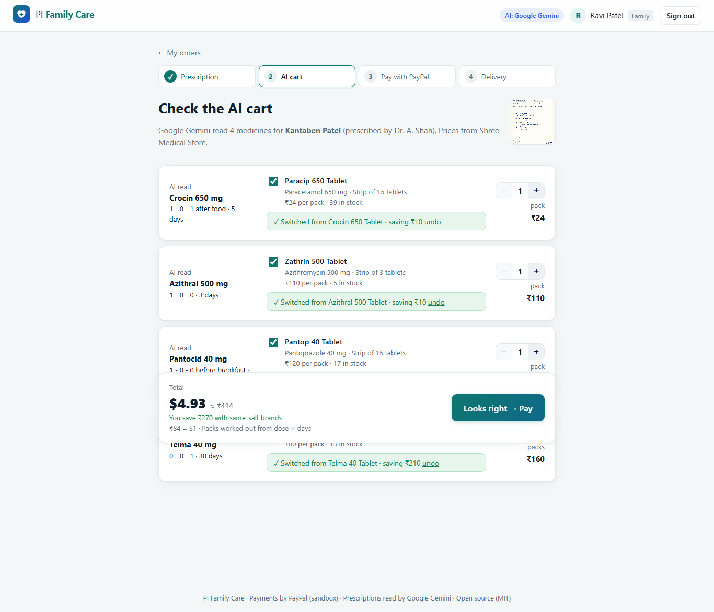
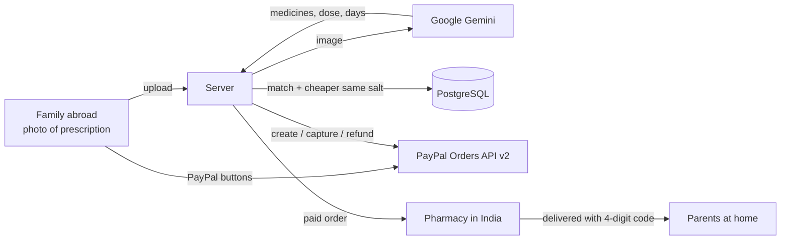
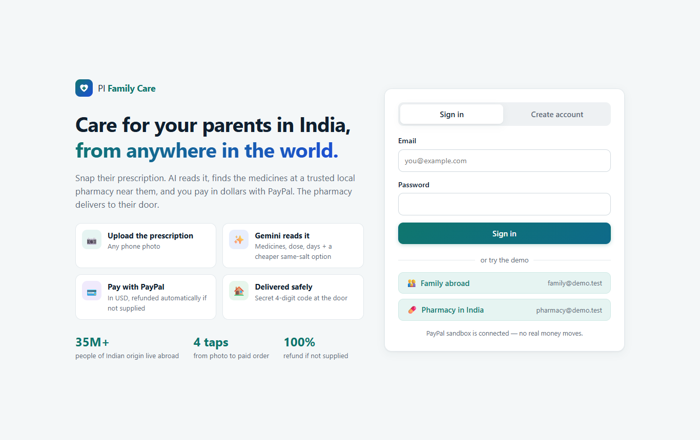
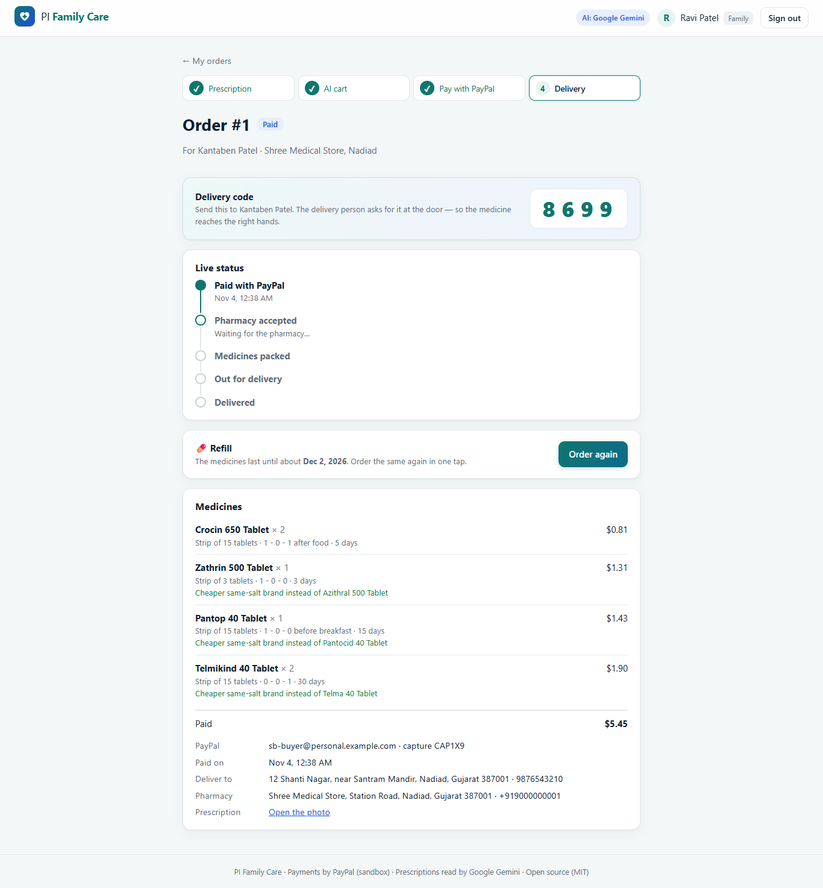
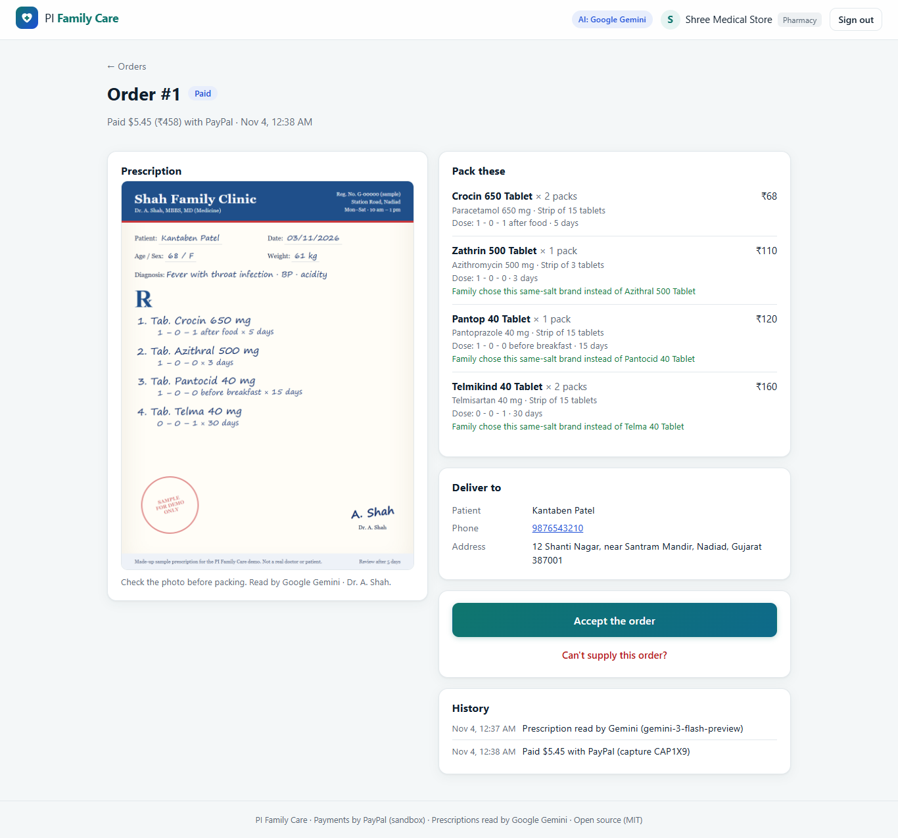
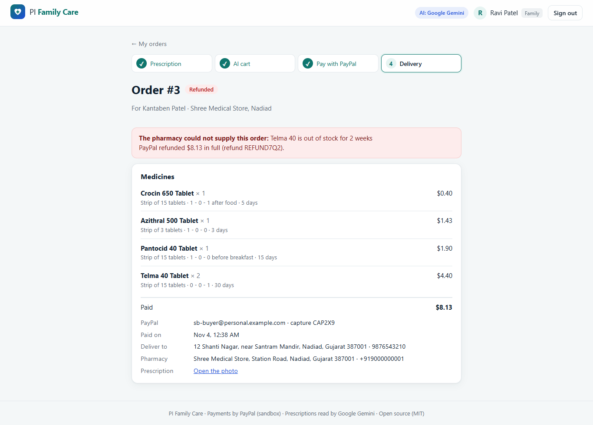
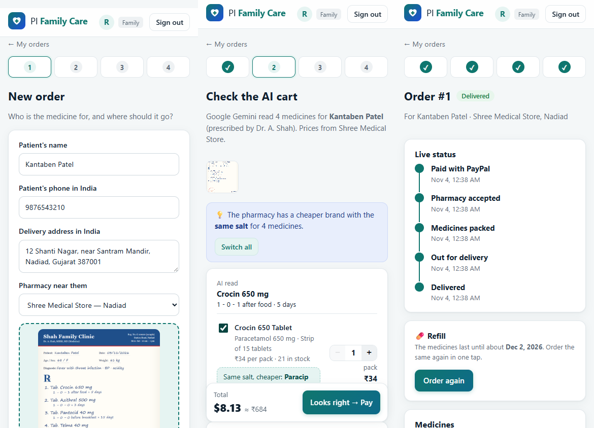

# PI Family Care

**Order medicine for your parents in India, from anywhere in the world.**

You live abroad and your parents live in India. When their doctor writes a new prescription, you take a photo of it. **Google Gemini reads it** and finds each medicine at a trusted local pharmacy near them, along with a cheaper brand with the same salt. You **pay in US dollars with PayPal**, and the pharmacy delivers to their door. A secret 4-digit code makes sure the medicine reaches the right person. If the pharmacy can't supply the order, **PayPal refunds you in full automatically**.

Built for the **PayPal AI Hackathon** (Devpost).



---

## Why this matters

About 35 million people of Indian origin live outside India, and many have parents who stay behind. Ordering medicine for them from far away is harder than it sounds:

- You can't read the doctor's handwriting from a WhatsApp photo.
- Indian pharmacies want UPI or cash. Your card or PayPal from abroad usually doesn't work.
- You never know whether the medicine actually arrived, or arrived at the right house.
- The same salt is often sold under a cheaper brand, but you don't know which one.

PI Family Care solves all four in one flow.

## What it does

| Step | Who | What happens |
|---|---|---|
| 1. Prescription | Family abroad | Upload a photo, or click **Use the sample prescription** |
| 2. AI cart | **Google Gemini** | Reads every medicine with its strength, dose (1-0-1) and days. Each line is matched to the pharmacy's real shelf, with packs worked out from dose × days. A **cheaper same-salt brand** is offered with one tap, and an out-of-stock brand switches to its in-stock same-salt brand automatically. |
| 3. Pay | **PayPal Checkout** | Pay in USD with the PayPal buttons (JS SDK). The server creates and captures the order (Orders API v2). The amount always comes from the database, never from the browser. |
| 4. Pharmacy | Local pharmacy in India | Sees the paid order and the prescription photo, then works through **Accept → Packed → Out for delivery** |
| 5. Delivery | Patient | Gives the **4-digit delivery code** at the door. The pharmacy can't mark the order delivered without it, and it never sees the code in the app. |
| ↩ Refund | PayPal | "Can't supply" → **full PayPal refund** (Payments API) automatically, the medicines go back on the shelf and the family sees why |
| 🔁 Refill | Family | The app knows when the medicine runs out (longest course). **Order again** makes the same order in one tap. |

The family follows every step live.

## How PayPal and AI are used

**PayPal (sandbox)**: [server/src/services/paypal.js](server/src/services/paypal.js)
- OAuth 2.0 client credentials, with the token cached.
- **Orders API v2** `POST /v2/checkout/orders` with the item list, `custom_id` = our order id and `PayPal-Request-Id` for idempotency.
- **Capture** `POST /v2/checkout/orders/{id}/capture`. Before an order is marked paid, the server checks the status, currency, **exact amount** and `custom_id`.
- **Refund** `POST /v2/payments/captures/{id}/refund` when the pharmacy can't supply.
- **PayPal JS SDK** buttons in the browser ([client/src/pages/OrderPage.jsx](client/src/pages/OrderPage.jsx)). The secret never leaves the server.

**Google Gemini**: [server/src/services/gemini.js](server/src/services/gemini.js)
- The photo is sent to `generateContent` with a strict JSON prompt: name, strength, form, dose, days.
- The answer is cleaned (e.g. "Tab. Crocin" becomes "Crocin", "5 days" becomes 5) and then matched to 500 Indian medicines in PostgreSQL with `pg_trgm` fuzzy search ([server/src/services/matcher.js](server/src/services/matcher.js)).
- If a Gemini model is busy or retired, the app falls back to the next model, so the demo keeps working.



## Run it yourself (about 5 minutes)

You need **Node.js 20+** and **PostgreSQL 14+** (both free).

```bash
git clone https://github.com/shefilvhora545-art/pi-family-care.git
cd pi-family-care
npm install            # installs the server and the screens
```

Copy `.env.example` to `.env` and fill in:

| Setting | Where to get it (free) |
|---|---|
| `DATABASE_URL` | Your PostgreSQL password goes in this line. The database is created for you. |
| `PAYPAL_CLIENT_ID` / `PAYPAL_CLIENT_SECRET` | [developer.paypal.com](https://developer.paypal.com) → Apps & Credentials → **Sandbox** → Default Application |
| `GEMINI_API_KEY` | [aistudio.google.com/apikey](https://aistudio.google.com/apikey) → Create API key. If you leave it empty, a clearly labelled **demo reader** is used (it only knows the sample prescription). |

```bash
npm run setup          # database, 500 medicines, 2 pharmacies, demo accounts + builds the screens
npm start              # → http://localhost:4000
```

On Windows PowerShell, use `npm.cmd` in place of `npm` if scripts are blocked.

### Try it

1. Click **Family abroad** (`family@demo.test` / `Demo@1234`).
2. **＋ New order** → **Use the sample prescription** → **Read with AI**.
3. Check the AI cart and tap the cheaper same-salt brands → **Looks right → Pay**.
4. Pay with a **sandbox Personal account** (developer.paypal.com → Testing Tools → Sandbox Accounts → Create account → Personal, country **United States**). No real money moves.
   > If your sandbox business account is in **India**, the buyer must be from **another country**. PayPal does not allow India-to-India payments, and you would see "Things don't appear to be working at the moment". A US buyer matches the story: family abroad, pharmacy in India.
5. Sign out → **Pharmacy in India** (`pharmacy@demo.test` / `Demo@1234`) → open the order → Accept → Packed → Out for delivery → type the family's 4-digit code.
6. Try **Can't supply this order?** on another order to see the automatic PayPal refund.

A second pharmacy login is `pharmacy2@demo.test` (Care Plus Pharmacy, Ahmedabad). The sample prescription is in [docs/sample-prescription.png](docs/sample-prescription.png). It is made up: not a real doctor or patient.

## Tests

```bash
cd server
npm test
```

34 end-to-end API tests run against their **own fresh database**, a **fake PayPal** server and a fake Gemini server, so no real money or keys are used. They cover login and access rules, the AI cart, prices that can't be changed from the browser, PayPal create/capture (wrong amount → not paid, double capture → no double stock cut), every pharmacy step, the wrong delivery code, refund (including a failed refund), refill, and the Gemini model fallback.

## Safety

- Prices, totals and stock always come from the database. The browser only sends medicine ids and pack counts.
- An order is marked paid only after PayPal's capture matches the **amount, currency and our order id**.
- Every order is visible only to its own family and its own pharmacy, and the pharmacy never sees the delivery code.
- Passwords are hashed with bcrypt, and sessions are kept in PostgreSQL in httpOnly cookies.
- Helmet sets a Content-Security-Policy that only allows PayPal's own domains.
- No keys are in this repository. `.env` is git-ignored.

## Screenshots

| Sign in | Live tracking + delivery code |
|---|---|
|  |  |
| **Pharmacy order** | **Automatic refund** |
|  |  |



## Built with

Node.js · Express 5 · PostgreSQL (`pg_trgm`) · React 19 · Vite · **PayPal Orders API v2 + Payments API + JS SDK (sandbox)** · **Google Gemini API**

## How it was built

I built this project with **Claude (Anthropic) as my AI coding partner**. I designed the idea and the flow, made the decisions, set up the PayPal sandbox and Gemini, and tested it. Claude helped write and test the code.

The medicine list comes from my own pharmacy project. The exchange rate is fixed in `.env` (`INR_PER_USD`) to keep the demo simple.

## Licence

[MIT](LICENSE) © Shefil Vhora
